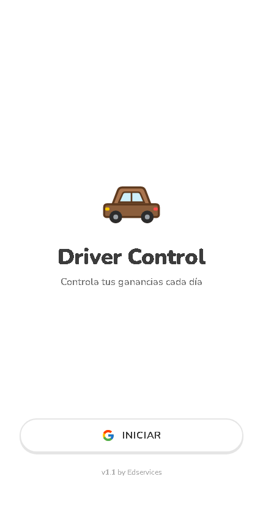
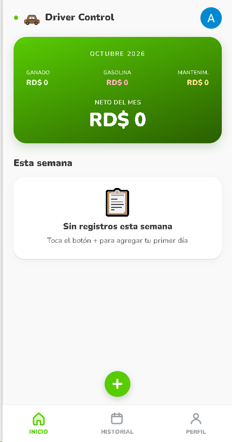
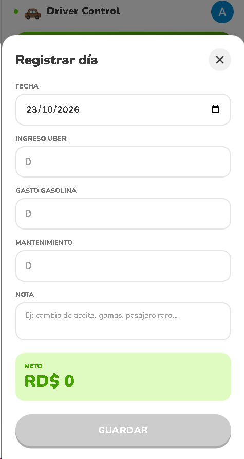
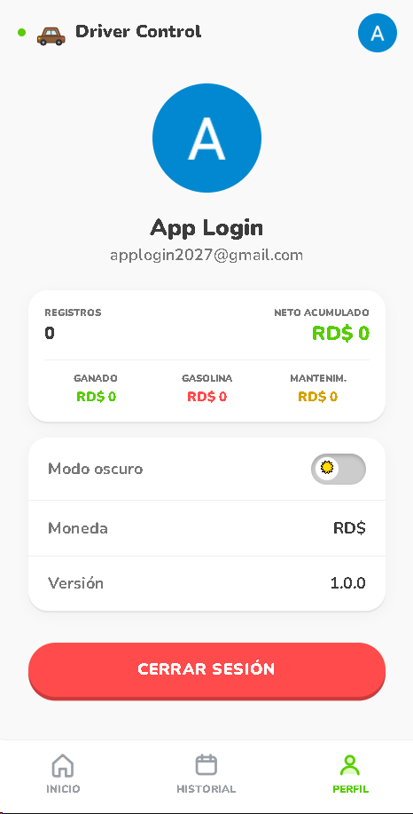

# Driver Control

<p>
  
  
  
  
</p>

PWA (Progressive Web App) para que un conductor de Uber/apps de transporte
registre, día por día, cuánto ganó y cuánto gastó (gasolina, mantenimiento) y
vea su neto — por semana, por mes y acumulado. Un solo archivo HTML, sin paso
de build, con autenticación de Google y datos sincronizados en tiempo real
vía Firebase.

## Qué hace

- **Registro diario**: ingreso, gasto de gasolina, gasto de mantenimiento y
  una nota libre por fecha. El neto del día se calcula al instante.
- **Inicio**: tarjeta con el resumen del mes actual y la lista de registros
  de la semana en curso.
- **Historial**: todos los meses con registros, cada uno con su neto y una
  barra comparándolo contra el mejor mes; al entrar a un mes se ve el
  desglose completo y cada día registrado.
- **Perfil**: foto/nombre/correo de Google, totales acumulados de toda la
  cuenta, modo oscuro, y cerrar sesión.
- **Instalable como app** (PWA): ícono en el manifest, service worker propio
  (`sw.js`) y una tarjeta en la UI que ofrece "Instalar app" (o las
  instrucciones manuales en iOS/Safari, que no soporta el prompt nativo).
- **Indicador de sincronización**: un punto junto al logo muestra si los
  datos están sincronizados, guardándose, sin conexión o con error.

## Stack técnico

| Capa | Tecnología |
|------|------------|
| UI | React 18 (UMD vía CDN) + JSX transformado en el navegador con Babel Standalone — sin paso de build |
| Estilos | Tailwind CSS v4 (CDN) + CSS inline, tipografía Nunito (Google Fonts) |
| Autenticación | Firebase Auth (Google Sign-In, con fallback de popup a redirect en móvil) |
| Base de datos | Firebase Realtime Database, un árbol `users/{uid}/registros/{fecha}` por usuario |
| PWA | `manifest.json` + `sw.js` (service worker) para instalación y funcionamiento offline básico |
| Hosting | Firebase Hosting (`firebase.json`, `.firebaserc`) |

No hay backend propio: todo corre en el navegador y habla directo con los
servicios de Firebase vía el SDK v10 (modo *compat*, cargado por CDN).

## Estructura del proyecto

```
Driver Control/
├── index.html          — toda la app: configuración de Firebase, estilos y componentes React en un solo archivo
├── manifest.json        — metadata de la PWA (ícono, nombre, colores, modo standalone)
├── sw.js                 — service worker (cache / instalación offline)
├── icon-192.svg / icon-512.svg  — íconos de la app
├── firebase.json          — configuración de Firebase Hosting (reglas de cache, rewrites a index.html)
├── .firebaserc             — ID del proyecto Firebase (drivercontrol-4c88b)
├── .firebaseignore         — archivos excluidos del despliegue
└── colaboraciones/          — reportes de cada etapa de desarrollo (REPORTE_ETAPA1/2/3.md)
```

## Cómo correrlo / desplegarlo

Al ser un sitio estático sin build, basta con servir la carpeta:

```bash
npx serve .
# o cualquier servidor estático, o abrir index.html directo en el navegador
```

Para desplegar a Firebase Hosting (requiere `firebase-tools` y estar
autenticado con la cuenta dueña del proyecto `drivercontrol-4c88b`):

```bash
firebase deploy --only hosting
```

### Firebase — configuración necesaria

El bloque `firebaseConfig` ya está embebido en `index.html` (la `apiKey` de
un SDK web de Firebase es pública por diseño, no es un secreto — el acceso
real se controla con las reglas de seguridad de la base de datos, no
ocultando esta clave).

Reglas de **Realtime Database** requeridas (cada usuario solo puede leer/escribir
sus propios datos), documentadas también en un comentario dentro de
`index.html`:

```json
{
  "rules": {
    "users": {
      "$uid": {
        ".read": "$uid === auth.uid",
        ".write": "$uid === auth.uid"
      }
    }
  }
}
```

Y en **Authentication → Sign-in method** debe estar habilitado el proveedor
**Google**.

## Modelo de datos

```
users/
  {uid}/
    meta/
      migrated: true            — bandera de migración única desde localStorage (ver abajo)
    registros/
      {YYYY-MM-DD}/
        ingreso: number
        gasolina: number
        mantenimiento: number
        nota: string
        neto: number             — calculado y guardado en el write (ingreso - gasolina - mantenimiento)
        updatedAt: ServerValue.TIMESTAMP
```

Un documento por fecha, clave = fecha ISO. Guardar un registro en una fecha
existente lo sobrescribe (la UI avisa antes de hacerlo).

### Migración desde la v1 (localStorage)

La primera versión del proyecto (ver `colaboraciones/REPORTE_ETAPA1.md`)
guardaba los registros en `localStorage` del navegador (`driver-control-records-v1`).
Al iniciar sesión por primera vez con Firebase, `migrateLocalStorageIfNeeded()`
copia esos registros a Realtime Database, marca `meta/migrated = true` y
borra la copia local — ocurre una sola vez por usuario.

## Reglas de diseño

Estética inspirada en Duolingo: tarjetas redondeadas con sombra "3D"
(`box-shadow` que simula profundidad bajo el botón, se aplana al presionar),
verde como color de éxito (`#58CC02`), rojo para alertas/eliminar
(`#FF4B4B`). Modo oscuro completo vía clases Tailwind sobreescritas en CSS
(no hay modo oscuro nativo de Tailwind configurado, se hace a mano por
selector de atributo de clase).

## Documentación adicional

`colaboraciones/` contiene el reporte de cada etapa de desarrollo
(`REPORTE_ETAPA1.md`: versión inicial con localStorage; `REPORTE_ETAPA2.md`:
cuentas de Google y sincronización en Firebase; `REPORTE_ETAPA3.md`: PWA
instalable + indicador de sincronización).
